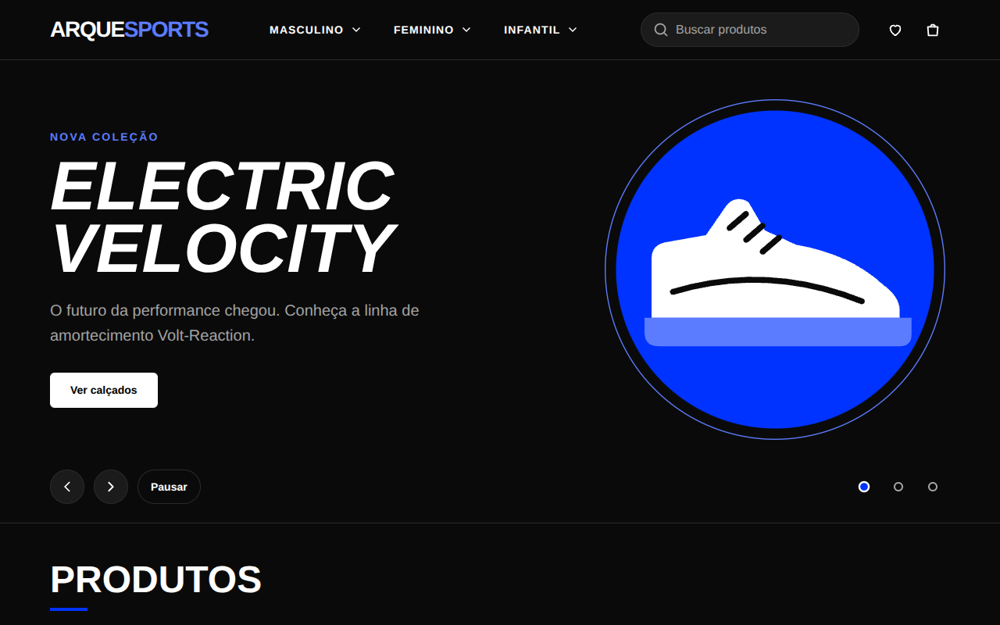
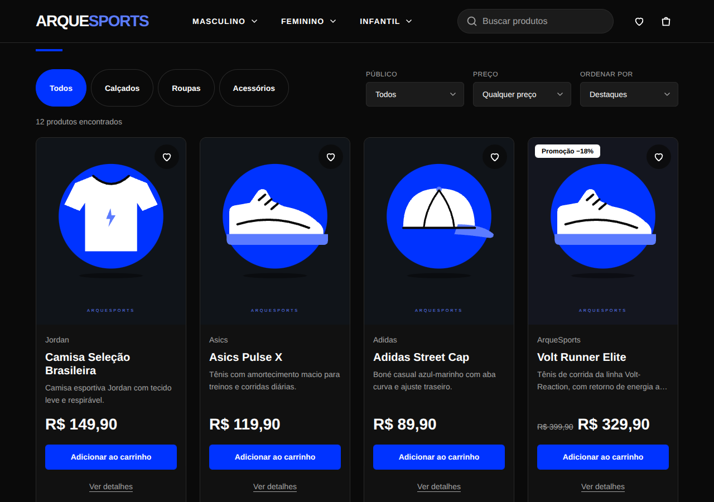
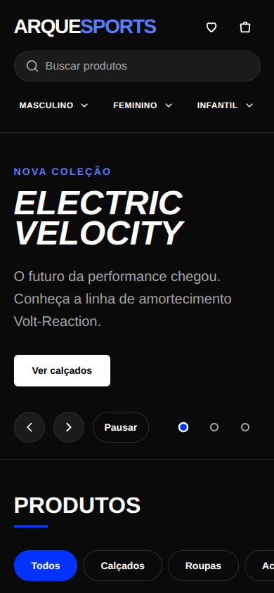

# ARQUESPORTS

Loja virtual esportiva feita com **HTML, CSS e JavaScript puro** (módulos ES), sem frameworks nem bibliotecas em tempo de execução.
Projeto acadêmico de Ciências da Computação, evoluído para portfólio.

> **Aviso:** o checkout é **demonstrativo**. Nenhuma cobrança é feita e nenhum dado do formulário é enviado ou salvo.
> Para testar, use o cartão `4111 1111 1111 1111`, qualquer validade futura e qualquer CVV.

## Prévia

| Início                                     | Produtos                                        | Celular                                          |
| ------------------------------------------ | ----------------------------------------------- | ------------------------------------------------ |
|  |  |  |

## Como executar

Os módulos ES não funcionam com duplo clique (`file://`). Sirva a pasta por HTTP:

- **VS Code:** abra a pasta do projeto (a que contém `index.html`), botão direito em `index.html` → _Open with Live Server_
- **Terminal:** `python -m http.server 8000` dentro desta pasta e abra `localhost:8000`

## Funcionalidades

- Catálogo renderizado por JavaScript a partir de uma única fonte de dados
- Busca (nome, marca e descrição, sem diferenciar acentos), filtros por categoria, público e faixa de preço, ordenação
- Favoritos, com filtro "somente favoritos"
- Modal de detalhes do produto
- Carrinho em gaveta: adicionar, remover, alterar quantidade, subtotal, frete (grátis a partir de R$ 299,00) e total
- Carrinho e favoritos persistem no `localStorage` e ficam sincronizados entre abas do navegador
- Limite de 10 unidades por produto, com aviso quando o limite é atingido
- Checkout com máscaras, validação (Luhn, validade real), erros acessíveis e confirmação demonstrativa
- Menu de navegação e carrossel de destaques acessíveis por teclado e toque

## Estrutura

```
index.html, checkout.html
css/       variaveis.css (cores, espaçamentos, fontes) · base.css · componentes.css · cabecalho.css · destaques.css · checkout.css
js/
  dados/produtos.js            fonte única dos produtos (preços em centavos)
  dados/imagens.js             gerado por "npm run fotos"
  carrinho.js favoritos.js catalogo.js validadores.js formatar.js armazenamento.js    lógica, sem DOM
  interface/renderizar.js gaveta-carrinho.js menu.js destaques.js                     construção da interface
  principal.js checkout.js                                                            estado e eventos de cada página
docs/      capturas de tela usadas neste README
recursos/  icone.svg · imagens/ (placeholders SVG, um por produto) · imagens/fotos/ (fotos reais)
scripts/   gerar-placeholders.mjs · aplicar-fotos.mjs · verificar-*.mjs
```

## Convenção de nomes

Todo o código que é nosso está em português: classes CSS (`.card-produto`, `.caixa-busca`, `.gaveta`), ids (`carrinho-botao`),
atributos `data-*` (`data-adicionar`), variáveis CSS (`--cor-marca`, `--espaco-4`), funções (`adicionarItem`, `calcularTotais`)
e arquivos. Continuam em inglês apenas o que pertence à linguagem ou ao navegador: palavras-chave do JavaScript, métodos
(`addEventListener`, `.sort()`), atributos HTML (`src`, `aria-label`) e propriedades CSS.

## Decisões técnicas

- **Preços em centavos (inteiros):** evita erros de ponto flutuante; a formatação em reais é feita só na exibição (`Intl.NumberFormat`).
- **O carrinho guarda só `{ id, quantidade }`:** nome e preço são lidos do catálogo, então não há dado duplicado para ficar desatualizado.
- **Funções puras e imutáveis** para carrinho, catálogo, favoritos e validação: testáveis em Node, sem navegador.
- **Interface = função do estado:** eventos atualizam o estado e a tela é redesenhada a partir dele.
- **Sem `innerHTML`:** elementos são criados com `createElement` + `textContent`, então nenhum dado é interpretado como HTML.
- **`<dialog>` nativo** para carrinho e detalhes (foco preso, Esc, fundo inerte).
- **Variáveis CSS:** nenhuma cor fixa fora de `variaveis.css`; o contraste (WCAG AA) é calculado em teste.
- **`localStorage` é tratado como entrada não confiável:** os dados são validados ao ler.

## Fotos reais dos produtos

Salve uma foto por produto em `recursos/imagens/fotos/` (nome do arquivo = id do produto) e rode `npm run fotos`.
Instruções e sugestões de busca em `recursos/imagens/fotos/LEIA-ME.md`.

## Testes

Precisa de Node 18+.

| Comando                            | O que verifica                                                                                                                                           |
| ---------------------------------- | -------------------------------------------------------------------------------------------------------------------------------------------------------- |
| `npm test`                         | Carrinho, catálogo, favoritos, validadores, contraste das cores e auditoria estática (links, imports, padrões proibidos, variáveis CSS, arquivos vazios) |
| `npm install` + `npm run test:dom` | Fluxos de tela em DOM simulado (jsdom): carrinho, favoritos, detalhes, menu, destaques e checkout                                                        |
| `npm run placeholders`             | Regera as imagens SVG a partir de `js/dados/produtos.js`                                                                                                 |

## Desenvolvimento

```bash
npm install                  # dependências de desenvolvimento (jsdom e prettier)
npm run formatar             # formata o código com Prettier
npm run verificar-formatacao # confere a formatação sem alterar arquivos
```

O GitHub Actions (`.github/workflows/testes.yml`) roda `npm test`, `npm run test:dom` e a verificação de formatação a cada push.

## Publicação

O projeto não precisa de build. Para publicar no GitHub Pages: _Settings → Pages → Deploy from a branch → `main` / `(root)`_.

## Navegadores suportados

Versões atuais de Chrome, Edge, Firefox e Safari. O projeto usa recursos modernos de HTML e CSS
(`<dialog>`, `inert`, `:has()`, `aspect-ratio`, `dvh` e propriedades de transformação individuais).
Em navegadores antigos o layout pode degradar, e os slides ocultos do carrossel continuam focáveis por Tab.

## Limitações conhecidas

- Imagens são placeholders locais; fotos reais entram com `npm run fotos`.
- Não há back-end: catálogo, pedidos e pagamento são simulados.
- Não foi testado com leitor de tela real nem em dispositivos físicos.
- Os testes de DOM usam jsdom, que não renderiza CSS nem implementa `<dialog>` por completo.

## Melhorias futuras

- Fotos reais otimizadas (WebP/AVIF, `srcset`)
- Estado dos filtros na URL (links compartilháveis) e página própria por produto
- Paginação ou "carregar mais" e debounce na busca se o catálogo crescer
- Back-end com API de produtos e pedidos; pagamento real via gateway
- Testes de ponta a ponta em navegador real (Playwright) e auditoria Lighthouse
- Tema claro, internacionalização e cálculo de frete por CEP
